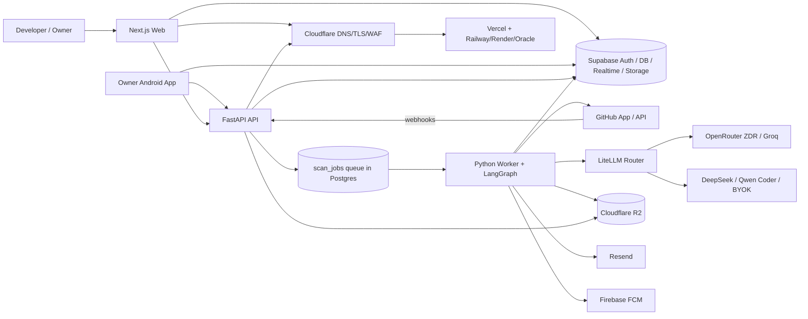
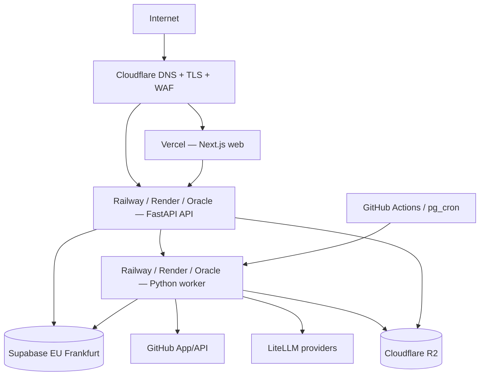

# plan.md — Mirsad v1 Beta

| Field | Value |
|---|---|
| Status | Approved for implementation planning — derived from Product Brief v1.0 |
| Product | Mirsad (مرصاد) |
| Scope | v1 Beta: web app + Android owner companion + PDF report |
| Last updated | 2026-11-22 |
| Source of truth | Approved Product Brief v1.0 + the 100-question decision log |
| Companion docs | `design.md` (UX/UI), `AGENTS.md` (coding-agent rules) |

> **Deployment decision (final):** The approved topology is the **$0 Free-Tier stack**: Vercel
> (Hobby) for the Next.js web app; Railway / Render / Oracle Cloud Free Tier for the FastAPI API and
> Python worker; Supabase (EU Frankfurt) for Auth/Postgres/Realtime/Storage; Cloudflare R2 for
> backups and audit archives; Cloudflare for DNS/TLS. Free tiers are for development and the
> non-commercial beta only; a commercial hosting upgrade (e.g., Vercel Pro + an always-on worker
> host) is a hard prerequisite before payments in v2. Free-tier constraints (sleeping workers, cold
> starts, quotas) are tracked as risks in §21.
>
> Anything marked **TBD** is an open decision and must not be invented during implementation.

---

## 1. Product goals and success metrics

### 1.1 Product goal

Give mid-size companies (20–250 employees, 3–25 developers, no internal AppSec team) a continuous,
evidence-based application security loop: **Red finds and proves → Blue patches via GitHub PR →
human merges → Red re-attacks and verifies** — with honest coverage reporting and no auto-merge.

### 1.2 Beta success metrics (measured over the first 10–15 beta companies)

| Metric | Target | Failure threshold |
|---|---|---|
| Activation: verify domain + first scan within 7 days | ≥ 60% | < 25% |
| False-positive rate on confirmed findings | < 5% | > 10% |
| PR merge rate | ≥ 40% | < 20% (and > 80% rejected) |
| Verified Fixed rate among merged PRs | ≥ 70% | < 50% |
| Week-4 retention (≥ 2 scans/month) | ≥ 50% | < 25% |
| Scan completion without critical worker error | ≥ 95% | < 90% |

### 1.3 Non-goals for v1

Payments, multi-user seats/RBAC, GitLab/Bitbucket/Slack/Jira, public API, iOS, cloud/IaC scanning,
asset discovery, shareable report links, 24/7 offensive monitoring, SOC2, E&O insurance.

---

## 2. MVP scope

### 2.1 In scope

| Area | v1 Beta commitment |
|---|---|
| Auth | GitHub OAuth only (web + Android PKCE) |
| Web pages | Dashboard, Domains, Pentests, Issues, PR Reviews, Settings (+ auth + onboarding) |
| Targets | Web apps + APIs (recon-first discovery) |
| Tier-1 stacks | Python (FastAPI/Django/Flask), Node/TS (Express/Next.js), PHP (Laravel), C#/.NET (ASP.NET Core) — phased: Python + Node/TS first, then PHP + .NET |
| Modes | Black Box (scan-only) + Grey Box (code-informed Red, white-box Blue) |
| Agents | Red + Blue under a deterministic LangGraph orchestrator; ~80% deterministic tools / ~20% LLM reasoning |
| GitHub | GitHub App (least privilege), PRs, webhooks (push, PR, deployment_status, installation, check_suite) |
| Outputs | Confirmed findings with sanitized PoC, PRs, PDF report, Coverage Receipt, Security Score |
| Alerts | Email (Resend) + FCM push (Android) |
| Mobile | Flutter Android owner companion: 4 read-only screens |
| Access | Invite-only/waitlist; 2 domains/workspace; 5 scans/month total/workspace; 1 owner |
| Ops | Supabase Studio + alerts; immutable audit log; GDPR-aware deletion |
| Legal | ToS + Privacy Policy + Beta DPA + consent checkbox + `/.well-known/security.txt` |

### 2.2 Out of scope

| Item | Target |
|---|---|
| Payments (Paddle/Lemon Squeezy + Paymob) | v2 |
| Multi-user teams + RBAC | v2 |
| GitLab, Bitbucket, Slack, Jira | v1.5/v2 |
| Public API + scoped API keys | v2 |
| iOS app | **Permanently out of scope** |
| Cloud/IaC/container scanning | v2/v3 |
| Asset discovery | **Cancelled** |
| Shareable report links | **Cancelled** (PDF download only) |
| 24/7 offensive monitoring | Not a product promise |
| SOC2, external pentest, paid bug bounty | v2/v3 |
| E&O insurance | v2/v3 |
| Arabic/RTL UI | v2 |

### 2.3 Beta limits

- 2 domains per workspace (Staging + Production of the same project).
- **5 scans per month per workspace in total**, shared across both domains.
- 1 Workspace Owner.
- Free during beta; early adopters get a permanent 50% discount on their first paid plan.

---

## 3. Team, timeline, and implementation phases

### 3.1 Team (5 humans, part-time)

| Role | Responsibility | Capacity |
|---|---|---|
| AI Engineer (Lead Architect) | LangGraph agents, LLM routing, prompt-injection defense, golden suite, patch evaluation | 15–20 h/week |
| Full-Stack Engineer | Next.js, FastAPI, worker orchestration, Supabase/RLS, GitHub App/webhooks | 15–20 h/week |
| Cyber Security Specialist | Deterministic playbooks, egress/SSRF guard, FP calibration, vulnerable fixtures, internal red team | 15–20 h/week |
| Flutter Developer | Android companion app (4 screens, OAuth PKCE, FCM) | 15–20 h/week |
| UI/UX Designer | Figma identity/system, web/mobile screens, PDF template, usability tests | 15–20 h/week |

Ops rotation during beta: 15 minutes/day shared by the AI Engineer and Cyber Security Specialist.

### 3.2 Timeline

**14–16 weeks** from implementation start to beta launch, with an internal milestone at **week 10**:
web app + Red/Blue loop working end-to-end.

| Phase | Weeks | Deliverables | Exit criteria |
|---|---|---|---|
| **0 — Foundation** | 1–2 | Monorepo, CI, design tokens, Supabase schema/RLS, GitHub OAuth, app shell | Sign-in + workspace + empty dashboard on staging |
| **1 — Core scan engine** | 3–6 | Egress guard, crawler/recon, deterministic playbooks, Red agent, fixtures, golden suite (Python + Node/TS) | Golden suite runs; recall/FP measured on fixtures |
| **2 — Blue + GitHub loop** | 7–9 | Blue agent, GitHub App, PR flow, CI check_suite, re-attack, PDF v1 | One end-to-end loop: find → PR → merge → verified |
| **3 — Web product** | 10–12 | All 6 pages, score, Coverage Receipt, alerts, settings, onboarding polish | **Week 10 milestone:** web + loop E2E; UX acceptance §13 |
| **4 — Hardening** | 13–14 | Security suite, DR drill, kill switch, performance, accessibility, legal pages | Go/No-Go checklist green |
| **Buffer / Beta** | 15–16 | Beta onboarding, monitoring, first 10–15 companies | Beta launch |
| **Parallel — Mobile** | 3–14 | Flutter owner companion, FCM, distribution | Installable APK; web launch does not depend on it |
| **Parallel — PHP/.NET** | 11–14 | Tier-1 support for Laravel + ASP.NET Core | Golden suite passes for both |

**Scope-cut levers if time is tight (pre-agreed):**

1. Ship Beta with **Python + Node/TS only**; defer PHP/.NET to v1.5.
2. Ship a single simplified PDF template.
3. Delay the Android app to v1.5 (web + email alerts only) — only if the Flutter track slips.

---

## 4. Architecture

### 4.1 System context



### 4.2 Core principles

1. **Deterministic-first:** 80% of scanning is code (HTTP client, crawler, playbooks, AST checks,
   sanitization, fingerprinting, scoring). LLM is used only where judgment adds value.
2. **Untrusted content isolation:** every target response is tagged as untrusted data, sanitized, and
   never placed in a system prompt. The LLM returns structured JSON only.
3. **Code-level egress guard:** every outbound request passes a proxy that enforces host match,
   blocks private/internal IPs and DNS rebinding, blocks cross-domain redirects, and rate-limits.
4. **Human gate:** Mirsad never auto-merges or auto-deploys. PR-only.
5. **Server-side authorization:** every sensitive action is validated in FastAPI; RLS is a backstop,
   not the only control.
6. **No raw traffic storage:** only sanitized PoCs for confirmed findings, coverage stats, and scan
   events.
7. **Observable by default:** every scan emits phase events, counters, token/cost telemetry, and a
   request ID.

### 4.3 Runtime components

| Component | Responsibility |
|---|---|
| **Next.js web** | UI, server components, Supabase session handling, calls to FastAPI |
| **FastAPI API** | Auth validation, domain/scan/finding APIs, report download, webhooks, realtime token |
| **Python worker** | Queue consumer, LangGraph orchestration, Red/Blue agents, egress guard, PDF generation |
| **Postgres queue** | `scan_jobs` with `FOR UPDATE SKIP LOCKED`; no Redis in v1 |
| **Supabase** | Auth, Postgres, Realtime, Storage (reports) |
| **Cloudflare R2** | Encrypted backups, audit JSONL archive |
| **Cloudflare** | DNS, TLS, WAF, rate limiting in front of the hosting platforms |
| **GitHub App** | Repo access, PR creation, webhooks |
| **LiteLLM router** | Provider abstraction, fallbacks, caps, BYOK |
| **Resend / FCM** | Email and push notifications |

---

## 5. Deployment topology (Free Tiers + Cloudflare)

### 5.1 Topology



### 5.2 Platform layout

| Component | Host | Notes |
|---|---|---|
| Next.js web | **Vercel Hobby** | Preview deployments for PRs; production from `main`/release tags. Hobby is non-commercial; upgrade before v2 payments. |
| FastAPI API | **Railway / Render / Oracle Cloud Free Tier** | Always-on preferred; Render free web services sleep after inactivity — use a keep-alive ping or a platform without sleep. |
| Python worker | **Railway / Render / Oracle Cloud Free Tier** | Must be **always-on** (no sleep): it consumes the queue. A sleeping worker stalls scans. |
| Database/Auth/Realtime/Storage | **Supabase Free** (EU Frankfurt) | Free-tier limits monitored; 7-day inactivity pause prevented by a 3-day ping. |
| Backups/audit archive | **Cloudflare R2 Free** | Encrypted `pg_dump` + append-only audit JSONL. |
| DNS/TLS/WAF | **Cloudflare** | Custom domains for `app` and `api`; Full (Strict), HSTS, rate limits. |
| Email / Push | **Resend Free / Firebase FCM** | Free-tier limits sufficient for beta; FCM free. |

### 5.3 Free-tier constraints and mitigations

| Constraint | Mitigation |
|---|---|
| Vercel Hobby is non-commercial | Beta only; upgrade to Vercel Pro (or equivalent) before v2 payments |
| Render free services sleep | Use keep-alive pings for the API; **never** host the worker on a sleeping plan — use Railway/Oracle or a paid always-on instance |
| Railway free/trial limits | Monitor usage; fall back to Oracle Free or a minimal paid instance |
| Oracle Free Tier capacity/reclaim | Keep infrastructure reproducible; monitor availability; have a fallback host |
| Supabase Free limits/pause | Pruning + retention; 80% alerts; 3-day ping; encrypted dumps to R2; upgrade path |
| Serverless timeouts | The worker is a long-running service, not a serverless function; never run scans in Vercel functions |
| Cold starts | Health checks + warm-up pings for API; worker stays warm |

### 5.4 Cloudflare configuration

- DNS:
  - `app.<domain>` → Vercel (CNAME, proxied).
  - `api.<domain>` → Railway/Render/Oracle custom domain (CNAME, proxied).
  - `staging-app.<domain>`, `staging-api.<domain>` → staging deployments (proxied, optionally
    access-restricted).
- TLS: **Full (Strict)** using the platform-managed certificates (Vercel/Railway/Render) or a
  Cloudflare Origin Certificate where supported; Always Use HTTPS; HSTS (6–12 months,
  includeSubDomains, preload only when confident); minimum TLS 1.2 (1.3 preferred).
- WAF: managed rules; rate limiting on `/api/v1/auth/*`, webhook endpoints, and scan creation; Bot
  Fight Mode evaluated carefully (must not block GitHub webhooks or legitimate API clients).
- GitHub webhooks: allowlist GitHub hook IP ranges or create a WAF bypass rule for
  `/api/v1/webhooks/github`; the application still verifies `X-Hub-Signature-256` (HMAC) — WAF is not
  the auth mechanism.
- Caching: static assets only; never cache API responses, reports, or authenticated pages.
- Keep the platform's default domains disabled or redirected where possible, so traffic goes through
  the branded Cloudflare hostnames.

### 5.5 Deploy flow

1. CI runs lint/typecheck/tests/security checks.
2. Web: Vercel builds previews per PR; merge to `main`/release tag promotes to production.
3. API/worker: Railway/Render/Oracle builds from the Dockerfile; staging deploys on merge to
   `staging`; production deploys on release tag with manual approval.
4. Migrations run as a one-off job (`supabase db push` or `psql`) **after** an encrypted backup;
   migrations must be backward-compatible.
5. Rollback: Vercel instant rollback; Railway/Render redeploy the previous build; restore the
   pre-migration dump if needed.
6. Health checks gate promotion; a short maintenance banner is acceptable during beta.

---

## 6. Project structure

```
mirsad/
├── apps/
│   ├── web/                     # Next.js (App Router), Tailwind, shadcn/ui
│   └── mobile/                  # Flutter (Android only)
├── services/
│   ├── api/                     # FastAPI, Pydantic, auth, REST endpoints
│   └── worker/                  # Python worker, LangGraph agents, egress guard, PDF
├── packages/
│   └── shared/                  # Shared schemas/types (OpenAPI-generated TS client)
├── supabase/
│   ├── migrations/              # SQL migrations
│   ├── policies/                # RLS policy SQL (reviewed)
│   └── tests/                   # RLS isolation tests
├── tests/
│   ├── e2e/                     # Playwright (web)
│   ├── security/                # SSRF/egress, canary leaks, prompt injection, webhook HMAC
│   ├── golden/                  # Golden detection suite + patch benchmark
│   └── load/                    # Queue/concurrency tests
├── fixtures/
│   ├── vulnerable-apps/         # Python, Node, PHP, .NET fixtures
│   └── seeds/                   # Seeded vulnerabilities + negative controls
├── infra/
│   ├── docker/                  # Dockerfiles for API/worker
│   ├── platform/                # Vercel/Railway/Render configs
│   └── scripts/                 # backup, restore, deploy, kill-switch
├── .github/
│   ├── workflows/               # CI, staging deploy, prod deploy, backups
│   └── pull_request_template.md
├── design.md
├── plan.md
└── AGENTS.md
```

**Conventions:** TypeScript strict; Python 3.12 with type hints; SQL migrations are append-only;
shared API types are generated from OpenAPI, not hand-written twice.

---

## 7. Tech stack decisions

| Layer | Choice | Rationale |
|---|---|---|
| Web | Next.js (App Router) + TypeScript strict | SSR, routing, server actions, strong ecosystem |
| UI | Tailwind CSS + shadcn/ui + Radix | Approved design direction; accessible primitives |
| Charts | Recharts via shadcn charts | Lightweight, composable |
| Mobile | Flutter (Android only) | Single codebase, team skill, free distribution |
| API | FastAPI + Pydantic v2 | Typed contracts, OpenAPI, async |
| Worker | Python 3.12 + LangGraph | Deterministic state machine + agent orchestration |
| HTTP client | httpx with a mandatory egress guard | Centralized SSRF/redirect/rate controls |
| Parsing | tree-sitter (multi-language) | Syntax/AST validation without compiling customer code |
| Queue | Postgres `scan_jobs` + `SKIP LOCKED` | No extra service; sufficient for beta concurrency |
| DB/Auth/Realtime/Storage | Supabase (EU Frankfurt) | Managed Postgres, RLS, OAuth, Realtime, Storage |
| LLM routing | LiteLLM (OpenAI-compatible) | Provider abstraction, fallbacks, BYOK |
| LLM providers | OpenRouter (ZDR-filtered) + Groq (triage); DeepSeek/Qwen Coder (patches, no-training) | Cost/quality balance; verified terms required |
| PDF | WeasyPrint | Python-native; lower RAM than Chromium/Playwright in the worker |
| Email | Resend | Free tier sufficient for beta |
| Push | Firebase Cloud Messaging | Android push, free |
| Backups | Cloudflare R2 + age/GPG | Free tier; off-site |
| CI/CD | GitHub Actions + platform builds | Native to the workflow |
| Hosting | Vercel (web) + Railway/Render/Oracle (API/worker) + Cloudflare DNS/TLS | Approved $0 free-tier topology for the beta |
| Monitoring | Sentry + Better Stack/UptimeRobot + Postgres telemetry | Errors, uptime, queue/scan metrics |

---

## 8. Data model

### 8.1 Entities and key columns

All tenant tables include `workspace_id` from day 1. `workspace_members` exists with a single owner
row in v1 to future-proof RLS for v2 multi-user.

| Table | Key columns | Notes |
|---|---|---|
| `workspaces` | `id`, `name`, `owner_user_id`, `plan`, `suspended_at`, timestamps | 1 per owner in v1 |
| `workspace_members` | `workspace_id`, `user_id`, `role` (`owner` in v1), timestamps | RLS helper; v2 roles |
| `profiles` | `id` (= auth user), `github_username`, `email`, `avatar_url` | No passwords |
| `domains` | `id`, `workspace_id`, `name`, `environment` (`staging`/`production`), `verification_status`, `verified_at`, `verification_method`, `consent_version`, `consent_at`, `consent_ip`, `repo_connection_id`, `next_scan_at`, timestamps | 2 per workspace in beta |
| `domain_verifications` | `id`, `domain_id`, `method` (`dns_txt`/`well_known_file`), `token_hash`, `status`, `checked_at`, `failure_reason`, `proof_hash` | Append attempts |
| `domain_auth_configs` | `id`, `domain_id`, `type` (`cookie`/`bearer`), `encrypted_value`, `updated_at` | Vault or AES-256-GCM; never returned raw |
| `repo_connections` | `id`, `workspace_id`, `installation_id`, `repo_id`, `repo_full_name`, `default_branch`, `status` (`connected`/`disconnected`), timestamps | GitHub App |
| `scans` | `id`, `workspace_id`, `domain_id`, `repo_connection_id`, `mode` (`black_box`/`grey_box`), `environment`, `trigger`, `status`, `started_at`, `finished_at`, `coverage` (jsonb), `score_before`, `score_after`, `llm_tokens`, `llm_calls`, `cost_estimate_usd`, `deterministic_ratio`, `parent_scan_id`, `target_finding_id`, `error_code`, `error_message` | Episode |
| `scan_jobs` | `id`, `scan_id`, `workspace_id`, `status`, `priority`, `attempts`, `lease_expires_at`, `heartbeat_at`, timestamps | Queue; `SKIP LOCKED` |
| `scan_events` | `id`, `scan_id`, `phase`, `level`, `message`, `metadata` (jsonb), `created_at` | Retention 14 days |
| `findings` | `id`, `workspace_id`, `domain_id`, `first_seen_scan_id`, `last_seen_scan_id`, `fingerprint`, `vuln_type`, `severity`, `confidence`, `status`, `endpoint_path`, `http_method`, `parameter`, `title`, `description`, `impact`, `owasp_category`, `evidence` (jsonb ≤ 50 KB), timestamps, `verified_at` | Deduplicated |
| `patches` | `id`, `finding_id`, `scan_id`, `repo_connection_id`, `branch_name`, `commit_sha`, `pr_number`, `pr_url`, `status`, `ci_status`, timestamps, `merged_at` | One PR per finding (or related in same file) |
| `reports` | `id`, `workspace_id`, `domain_id`, `scan_id`, `storage_path`, `status`, `generated_at`, `expires_at` | Private bucket |
| `notifications` | `id`, `workspace_id`, `user_id`, `type`, `title`, `body`, `read_at`, `metadata`, `created_at` | No sensitive payloads |
| `device_tokens` | `id`, `user_id`, `token`, `platform`, `created_at`, `last_seen_at` | FCM |
| `audit_logs` | `id`, `workspace_id`, `actor_user_id`, `action`, `resource_type`, `resource_id`, `ip`, `metadata` (jsonb), `created_at` | Append-only trigger; 12 months |
| `score_snapshots` | `id`, `workspace_id`, `domain_id`, `scan_id`, `score`, `coverage` (jsonb), `created_at` | Trend |
| `webhook_deliveries` | `id`, `delivery_id` (unique), `event`, `received_at`, `processed_at` | Retention 7 days |
| `plan_limits` | `workspace_id`, `plan`, `domains_limit`, `scans_per_month`, `scans_used`, `period_start`, `period_end`, `overage_policy` | Decoupled from payment provider |

### 8.2 Enums

- `environment`: `staging`, `production`
- `scan_status`: `queued`, `running`, `completed`, `partial`, `blocked`, `unreachable`, `failed`, `cancelled`
- `scan_trigger`: `manual`, `push`, `deploy`, `schedule`, `reverify`
- `severity`: `critical`, `high`, `medium`, `low`
- `confidence`: `confirmed`, `suspected`
- `finding_status`: `open`, `patch_needs_review`, `pr_open`, `waiting_deploy`, `verifying`, `verified_fixed`, `still_vulnerable`, `false_positive`, `wont_fix`, `regression`
- `patch_status`: `draft`, `pr_open`, `ci_failed`, `changes_requested`, `merged`, `closed`, `needs_rebase`, `regenerate_requested`
- `report_status`: `generating`, `ready`, `failed`

### 8.3 Fingerprint and deduplication

```
fingerprint = sha256(domain_id + "|" + vuln_type + "|" + normalized_endpoint + "|" + param_name)
```

- Path normalization: `/users/123` and `/users/456` → `/users/{id}`.
- Same fingerprint updates `last_seen_scan_id` instead of creating a new finding.
- A previously `verified_fixed` finding that reappears opens a **Regression** (reopened), not a
  duplicate.
- Unique constraint on `(domain_id, fingerprint)`; patch branch names are deterministic.

### 8.4 Indexes and constraints

- Every tenant table: index on `workspace_id`; composite indexes on `(workspace_id, created_at)`.
- `findings`: unique `(domain_id, fingerprint)`; index `(workspace_id, severity, status)`.
- `scans`: index `(domain_id, created_at desc)`; `(workspace_id, status)`.
- `scan_jobs`: partial index on `status = 'queued'` ordered by priority/created_at.
- `webhook_deliveries`: unique `delivery_id`.
- `patches`: unique `(repo_connection_id, branch_name)`; unique `(finding_id, pr_number)`.
- `audit_logs`: index `(workspace_id, created_at)`; trigger blocks `UPDATE`/`DELETE`.

### 8.5 Retention

| Data | Retention |
|---|---|
| `scan_events` (raw live logs) | 14 days (auto-prune) |
| Findings + reports | 90 days, or the last 10 scans per domain during beta |
| Report PDFs | Last 10 per domain during beta; 90-day default |
| `webhook_deliveries` | 7 days |
| `audit_logs` | 12 months (then auto-delete; anonymize on GDPR request) |
| Audit JSONL archive (R2) | 12 months, append-only |

Deletion flows stop running scans, delete findings/evidence/test cookies/PDFs, and retain only the
minimal legal audit proof.

---

## 9. Supabase authentication, authorization, and RLS

### 9.1 Authentication

- Supabase Auth with **GitHub OAuth** only. No email/password.
- Web: `@supabase/ssr` session cookies; server components and route handlers validate the session.
- Android: GitHub OAuth via **PKCE + deep link**, storing the session in secure storage.
- Access token ~1 hour; refresh token rotation; global sign-out revokes sessions and deletes FCM
  device tokens.
- If the GitHub App is uninstalled (`installation.deleted`): mark `repo_connections.disconnected`,
  pause Blue, notify the owner; the Mirsad session remains valid (read reports / scan-only).

### 9.2 Authorization model

- v1: one Workspace Owner. `workspace_members` has one `owner` row.
- FastAPI validates the Supabase JWT (JWKS), resolves the user, and checks workspace ownership on
  every request.
- The mobile app is read-only (except device token registration/removal and marking notifications
  read).
- The service role key is used **only** by the API/worker on the server; never in the browser, mobile
  app, logs, or GitHub.

### 9.3 RLS strategy

- RLS enabled and forced on every table containing `workspace_id`.
- Helper: `is_workspace_member(workspace_id)` checks `workspace_members` for `auth.uid()`.
- Storage bucket `reports` uses path `{workspace_id}/{domain_id}/{report_id}.pdf`; Storage RLS
  enforces workspace membership. Download uses a backend-generated signed URL (~60 seconds).
- API privileged paths (scan creation, webhook processing, worker writes) use the service role after
  explicit authorization checks; every query includes `workspace_id` explicitly.
- RLS is a backstop for direct Supabase access from web/mobile — not a substitute for API checks.

Example policy:

```sql
alter table public.domains enable row level security;
alter table public.domains force row level security;

create policy "members read domains"
on public.domains for select
using (public.is_workspace_member(workspace_id));

create policy "owner writes domains"
on public.domains for all
using (public.is_workspace_owner(workspace_id))
with check (public.is_workspace_owner(workspace_id));
```

### 9.4 Secrets

- Platform secrets (GitHub App private key, LLM keys, Resend, Firebase Admin, service role) live in
  server environment variables / platform secret stores, never in the database or client bundles.
- Customer test cookies/Bearer tokens: Supabase Vault or AES-256-GCM with a backend key; masked in
  the UI; clear/update action; alert on 401.
- GitHub installation tokens are generated on demand and expire within an hour; never stored.
- Rotation: platform keys every 90 days or on suspicion.

---

## 10. API contracts

Base path: `/api/v1`. JSON only. Auth: `Authorization: Bearer <supabase-jwt>` unless noted.

### 10.1 Error envelope

```json
{
  "error": {
    "code": "DOMAIN_NOT_VERIFIED",
    "message": "Verify domain ownership before running a scan.",
    "details": { "domain_id": "..." },
    "request_id": "..."
  }
}
```

- `400` validation, `401` unauthenticated, `403` forbidden/not owner, `404` not found, `409` conflict
  (duplicate domain, quota, scan already running), `422` semantic validation, `429` rate limit,
  `500` internal, `503` dependency unavailable.
- All errors include a `request_id`; never include secrets or stack traces.

### 10.2 Endpoints

| Method | Path | Purpose |
|---|---|---|
| GET | `/health` | Liveness (no auth) |
| GET | `/ready` | Readiness: DB, queue, worker heartbeat (no auth, minimal) |
| GET | `/me` | Current user + workspace + plan/usage |
| PATCH | `/workspace` | Rename workspace |
| GET | `/domains` | List domains + status |
| POST | `/domains` | Create domain (name, environment) |
| GET | `/domains/{id}` | Domain detail |
| PATCH | `/domains/{id}` | Update environment/next scan |
| DELETE | `/domains/{id}` | Delete domain (typed confirmation client-side) |
| POST | `/domains/{id}/verify` | Check DNS TXT or file |
| GET | `/domains/{id}/verification` | Verification attempts/status |
| PUT | `/domains/{id}/auth-config` | Set encrypted test cookie/Bearer |
| DELETE | `/domains/{id}/auth-config` | Clear test credentials |
| POST | `/domains/{id}/repo` | Link repo (installation + repo) |
| DELETE | `/domains/{id}/repo` | Disconnect repo |
| GET | `/domains/{id}/scans` | Scan history |
| POST | `/domains/{id}/scans` | Create manual scan (quota-checked) |
| GET | `/scans/{id}` | Scan detail |
| POST | `/scans/{id}/cancel` | Cancel running scan |
| GET | `/scans/{id}/events` | Paginated scan events (Realtime is primary) |
| GET | `/findings` | List/filter findings |
| GET | `/findings/{id}` | Finding detail + evidence |
| PATCH | `/findings/{id}` | Mark false positive / won't fix |
| POST | `/findings/{id}/regenerate-fix` | Regenerate patch (optional note) |
| POST | `/findings/{id}/reverify` | Focused re-attack |
| GET | `/patches` | PR status list |
| GET | `/patches/{id}` | PR detail |
| GET | `/reports` | Report list |
| POST | `/scans/{id}/report` | Generate report |
| GET | `/reports/{id}/download` | 60-second signed URL |
| GET | `/notifications` | Notification list |
| PATCH | `/notifications/{id}` | Mark read |
| POST | `/device-tokens` | Register FCM token |
| DELETE | `/device-tokens/{token}` | Remove FCM token |
| POST | `/webhooks/github` | GitHub webhook (HMAC; no JWT) |

### 10.3 Key request/response examples

**Create domain**

```http
POST /api/v1/domains
{
  "name": "app.example.com",
  "environment": "staging"
}
```

```json
{
  "id": "dom_...",
  "name": "app.example.com",
  "environment": "staging",
  "verification_status": "pending",
  "verification": {
    "method": "dns_txt",
    "record_name": "_mirsad-challenge.app.example.com",
    "record_value": "mirsad-verify=<token>"
  },
  "consent_required": true
}
```

**Create scan**

```http
POST /api/v1/domains/dom_.../scans
Idempotency-Key: 3f1c...
{ "trigger": "manual" }
```

```json
{
  "scan_id": "scan_...",
  "status": "queued",
  "quota": { "used": 2, "limit": 5, "period_end": "2026-12-01T00:00:00Z" }
}
```

**GitHub webhook**

```http
POST /api/v1/webhooks/github
X-GitHub-Delivery: <uuid>
X-GitHub-Event: pull_request
X-Hub-Signature-256: sha256=<hmac>
```

- Verify HMAC with `hmac.compare_digest` before parsing.
- Store delivery UUID for idempotency (7 days).
- State-machine guards ignore stale/out-of-order events.

### 10.4 Realtime

- Supabase Realtime channel per scan: `scan:{scan_id}` on `scan_events` inserts.
- RLS applies; clients can only subscribe to scans in their workspace.
- The web app falls back to polling `GET /scans/{id}/events` if Realtime disconnects.
- The mobile app subscribes to scan status/counters only (not raw logs).

### 10.5 Pagination and filtering

- Cursor pagination: `?limit=50&cursor=<opaque>`; response includes `next_cursor`.
- Findings filters: `domain_id`, `severity`, `status`, `confidence`, `vuln_type`, `endpoint`.
- Scans filters: `domain_id`, `status`, `trigger`, date range.

---

## 11. Integrations and workflows

### 11.1 GitHub App

**Permissions (least privilege):**

- Contents: Read & Write (read infected files, create patch branch).
- Pull requests: Read & Write (open/comment).
- Metadata: Read.
- Deployments: Read (`deployment_status`).
- Checks: Read (CI status).

**Behavior:**

- Branch: `mirsad/fix-<short-id>-<vuln-slug>`; never push to `main`/`master`.
- Commits via GitHub App API are signed/verified by GitHub.
- One PR per finding, or related findings in the same file.
- PR template: severity, summary, sanitized PoC, change explanation, testing instructions, CI note.
- Protected branches and required reviews work normally.
- Fetch the file tree and only infected files (no full clone); respect rate limits and
  `X-RateLimit-Reset`.
- No force push; conflicts → `Needs Rebase`.

**Webhooks:** `push`, `pull_request` (opened/closed/merged), `deployment_status`, `check_suite`,
`installation` (created/deleted). HMAC verification mandatory; idempotency via delivery UUID;
reconciliation poller every 15–30 minutes for missed events.

### 11.2 Scan workflow

1. Trigger: manual, push, deployment, schedule, or re-verify.
2. Queue job (`scan_jobs`) with workspace/domain; max 1 active scan per workspace; global 2–3.
3. Worker claims job (`SKIP LOCKED`), writes heartbeat/lease (2 minutes).
4. Phases: Verification & Recon → Probing Endpoints → Confirming Exploits → Blue Patching → Opening PR.
5. Each phase checkpoints (LangGraph + Postgres); findings are persisted as they are confirmed.
6. Hard caps: 15 minutes, 100K tokens or 25 LLM calls, 200–300 requests (Safe) / up to 600 (Deep).
7. On cap: graceful stop, save findings, mark **Partial coverage**.
8. Results: findings, coverage, score snapshot, report generation, notifications.
9. Re-verify: focused re-attack of one finding; append verification evidence.

### 11.3 LLM routing (LiteLLM)

- Triage/reasoning: OpenRouter ZDR-filtered providers + Groq (fast/cheap).
- Patch generation: DeepSeek / Qwen Coder via APIs with explicit no-training terms.
- Fallback chain with exponential backoff; provider abstraction so a provider can be swapped via env.
- BYOK: customers can supply their own provider key (Custom plan; optional earlier).
- No free tier that permits training on real customer data. Verify terms before enabling a provider.
- Structured JSON output only (Pydantic schema); no free-form tool/URL construction.

### 11.4 Email and push

- Resend templates: critical/high finding, PR ready, scan failed/blocked, quota warning, verification
  help. No sensitive payloads or PII in email bodies.
- FCM push: same event types; deep links to the app; device tokens removed on sign-out.

### 11.5 Scheduled scans

- `pg_cron` (or GitHub Actions cron) hourly: enqueue domains with `next_scan_at <= now()`, respecting
  the 5 scans/month workspace quota.
- Delays are acceptable; `next_scan_at + SKIP LOCKED` prevents duplicate scans.

### 11.6 PDF generation

- Renderer: **WeasyPrint** (Python-native; lower RAM than Chromium/Playwright in the worker).
- Input: sanitized report data + HTML/CSS template (light print theme).
- Output: PDF stored in Supabase Storage private bucket; 60-second signed URL for download.
- Generation runs in the worker; failure marks `report_status = failed` with retry.

---

## 12. Environment variables

> Values are **TBD** and must be provided via platform environment variables (Vercel/Railway/
> Render/Oracle), GitHub Actions secrets, or a local `.env` (never committed). Never commit real
> values.

### 12.1 Web (`apps/web`)

| Variable | Purpose |
|---|---|
| `NEXT_PUBLIC_SUPABASE_URL` | Supabase project URL (public) |
| `NEXT_PUBLIC_SUPABASE_ANON_KEY` | Supabase anon key (public; RLS-protected) |
| `SUPABASE_SERVICE_ROLE_KEY` | Server-only; never exposed to the browser |
| `NEXT_PUBLIC_API_BASE_URL` | Public API base URL (`https://api.<domain>/api/v1`) |
| `NEXT_PUBLIC_APP_URL` | Public app URL (`https://app.<domain>`) |
| `SENTRY_DSN` | Web error tracking |

### 12.2 API (`services/api`)

| Variable | Purpose |
|---|---|
| `DATABASE_URL` | Postgres connection (service role; TLS) |
| `SUPABASE_URL` | Project URL |
| `SUPABASE_ANON_KEY` | Anon key (if needed for scoped clients) |
| `SUPABASE_SERVICE_ROLE_KEY` | Server-only privileged access |
| `SUPABASE_JWT_SECRET` / `SUPABASE_JWKS_URL` | JWT validation |
| `GITHUB_APP_ID` | GitHub App ID |
| `GITHUB_APP_PRIVATE_KEY` | GitHub App private key (secret) |
| `GITHUB_CLIENT_ID` / `GITHUB_CLIENT_SECRET` | OAuth (if API participates) |
| `GITHUB_WEBHOOK_SECRET` | HMAC verification |
| `ENCRYPTION_KEY` | AES-256-GCM for customer secrets (if not using Vault) |
| `RESEND_API_KEY` | Email |
| `FCM_SERVICE_ACCOUNT_JSON` | Push notifications |
| `R2_ACCOUNT_ID`, `R2_ACCESS_KEY_ID`, `R2_SECRET_ACCESS_KEY`, `R2_BUCKET` | Backups/audit archive |
| `SENTRY_DSN` | API error tracking |
| `APP_ENV` | `development` / `staging` / `production` |
| `API_BASE_URL` | Internal/public base URL |

### 12.3 Worker (`services/worker`)

| Variable | Purpose |
|---|---|
| All API database/Supabase/GitHub/LLM/R2/Resend/FCM variables | Shared |
| `OPENROUTER_API_KEY` | Triage/reasoning (ZDR-filtered) |
| `GROQ_API_KEY` | Fast triage |
| `DEEPSEEK_API_KEY` | Patch generation (no-training terms) |
| `QWEN_API_KEY` | Patch generation fallback |
| `LITELLM_CONFIG_PATH` | Router config |
| `SCAN_MAX_DURATION_MIN` | Default `15` |
| `SCAN_MAX_TOKENS` | Default `100000` |
| `SCAN_MAX_LLM_CALLS` | Default `25` |
| `SCAN_MAX_REQUESTS_SAFE` | Default `300` |
| `SCAN_MAX_REQUESTS_DEEP` | Default `600` |
| `WORKER_CONCURRENCY` | Default `2`–`3` globally |
| `WORKER_LEASE_TIMEOUT_SEC` | Default `120` |

### 12.4 Mobile (`apps/mobile`)

| Variable | Purpose |
|---|---|
| `SUPABASE_URL` | Auth/Realtime/DB |
| `SUPABASE_ANON_KEY` | Public anon key |
| `API_BASE_URL` | API base |
| `FCM_PROJECT_ID` / `google-services.json` | Push (not a secret in the repo; injected at build) |

### 12.5 CI/CD (GitHub Actions secrets)

| Variable | Purpose |
|---|---|
| `VERCEL_TOKEN`, `VERCEL_ORG_ID`, `VERCEL_PROJECT_ID` | Web deploys |
| `RAILWAY_TOKEN` / `RENDER_API_KEY` / `ORACLE_*` | API/worker deploys (whichever platform is chosen) |
| `SUPABASE_ACCESS_TOKEN`, `SUPABASE_DB_PASSWORD` | Migrations |
| `R2_*` | Backup upload |
| `SENTRY_AUTH_TOKEN` | Source maps |
| `STAGING_*` / `PROD_*` | Environment-specific values |

---

## 13. Testing strategy

### 13.1 Test pyramid

| Layer | Tooling | Scope |
|---|---|---|
| Unit | pytest, Vitest | Pure functions: fingerprint, score, sanitizer, parsers, diff validation |
| Integration | pytest + Postgres (Supabase local) | API + DB + RLS, queue, webhooks |
| Contract | OpenAPI schema tests | API ↔ web/mobile clients |
| Security | pytest + custom harness | RLS isolation, SSRF/egress, canary leaks, prompt injection, HMAC |
| Golden detection | pytest + fixtures | Seeded vulnerabilities + negative controls |
| Patch benchmark | pytest + GitHub Actions fixtures | Patch correctness + functional tests + re-attack |
| E2E (web) | Playwright | Critical user journeys |
| Mobile | Flutter widget/integration tests | 4 screens, auth, push handling |
| Load | Locust/k6 | Queue/concurrency, 2–3 concurrent scans |
| DR | Scripted restore drill | Backup integrity + RTO |

### 13.2 Golden suite

- Fixtures: OWASP Juice Shop (Node/TS), DVWA (PHP), custom vulnerable micro-apps (Python, .NET) for
  BOLA/IDOR, SQLi, XSS, headers, secrets.
- 15–20 seeded vulnerabilities covering OWASP Web & API Top 10 + 10 negative-control endpoints.
- Acceptance: recall ≥ 80% for critical/high; FP < 5% on negative controls; 100% fingerprint
  stability.

### 13.3 Patch benchmark (closed loop)

1. Red detects the seeded vulnerability.
2. Blue opens a PR on the fixture repo.
3. GitHub Actions runs functional tests and deploys a staging copy.
4. Red re-attacks.
5. Acceptance: ≥ 85% AST/syntax valid; ≥ 75% functional tests pass; 0% destructive edits (no test
   deletion, no unrelated files, no random packages); E2E loop works.

### 13.4 Playwright E2E coverage (web)

| ID | Scenario | Assertions |
|---|---|---|
| E2E-01 | GitHub sign-in (mocked OAuth) → onboarding | Redirect, session, no email/password fields |
| E2E-02 | Add domain → DNS TXT verify (mocked) → first scan | Domain verified, scan queued, live logs appear |
| E2E-03 | Verification failure → retry → alternative method | Specific reason, retry works |
| E2E-04 | Scan-only → findings + Coverage Receipt + PDF | No "100% secure"; PDF downloads |
| E2E-05 | Grey-box: link repo → scan → PR created | PR appears in PR Reviews; stepper updates |
| E2E-06 | Merge webhook → re-attack → Verified Fixed | Score changes only after verification |
| E2E-07 | PR closed → issue stays open → false positive | No auto-reopen; status persists |
| E2E-08 | WAF blocked → banner → switch to staging | Blocked/partial state; receipt lists paths |
| E2E-09 | Zero findings → Coverage Receipt | Approved headline; blind spots visible |
| E2E-10 | Quota at 5/5 → scan disabled | Reset date; dashboard readable |
| E2E-11 | Settings: disconnect GitHub; delete domain/workspace | Tokens revoked, Blue paused, typed confirmation |
| E2E-12 | Responsive 375px | Drawer, stacked cards/diffs, no page scroll |
| E2E-13 | Accessibility | axe: no serious/critical violations; keyboard flow |
| E2E-14 | Session expiry / sign-out all devices | Re-auth; FCM token removed |

### 13.5 CI gates

- Lint + typecheck: `ruff`/`mypy` (Python), `eslint`/`tsc` (web), `flutter analyze` (mobile).
- Unit + integration + RLS tests.
- Security suite (must be 100% green).
- Golden suite (thresholds enforced).
- Playwright on staging for critical flows.
- Build verification (Next.js production build + API/worker Docker images).
- No merge with a red required check.

---

## 14. Security review

### 14.1 Threat model (summary)

| Threat | Control | Verification |
|---|---|---|
| Prompt injection from scanned content | Untrusted tags, structured JSON, no free-form URLs, code-level egress guard | Mock malicious server tests |
| SSRF / DNS rebinding | Host match, pre-connect DNS check, private IP block, redirect block | 100% block suite (metadata IP, hex/octal, `[::1]`, redirects) |
| Cross-tenant data leak | RLS on all tables + Storage RLS + API ownership checks | Two-tenant isolation tests |
| PII/secrets leakage | Deterministic sanitizer before DB and LLM; canary tests | Zero canary survival in DB, logs, PDF, prompts |
| GitHub token theft | On-demand installation tokens, least privilege, server-only secrets | Secret scanning, code review |
| Webhook spoofing/replay | HMAC `X-Hub-Signature-256`, delivery UUID idempotency, state guards | Unit + integration tests |
| Unauthorized scanning | Domain ownership verification, consent, egress host lock, Safe Mode | E2E + internal red team |
| Destructive actions | Hard refusals, non-mutating production mode, no auto-merge | Guardrail tests |
| Audit tampering | Append-only trigger, revoked update/delete roles, R2 JSONL | Immutability test |
| Dependency/supply chain | Dependabot, lockfiles, pinned images, secret scanning | CI |

### 14.2 Pre-beta security sprint

- Internal red team on Mirsad itself: prompt injection, SSRF/egress bypass, RLS isolation, webhook
  spoofing, JWT/IDOR, canary leaks.
- Acceptance: 100% security suite; no critical/high findings open.
- External pentest before paid launch (v2), plus peer review in late beta.
- `/.well-known/security.txt` and a security contact from day 1.

---

## 15. Monitoring and observability

| Area | Tool | Signal |
|---|---|---|
| Errors | Sentry (web, API, worker, Flutter) | Exceptions, release health |
| Uptime | Better Stack / UptimeRobot | `/health`, `/ready`, TLS expiry |
| Status page | Better Stack / Instatus free tier | Public incidents |
| Queue/scan telemetry | Postgres (`scans`, `scan_jobs`) | Queue depth, worker heartbeat, success/failure, WAF block rate, duration |
| LLM cost | Postgres (`scans.llm_tokens`, `cost_estimate_usd`) | Cost per scan, tokens, deterministic ratio |
| Hosting platforms | Vercel/Railway/Render/Oracle dashboards + logs | CPU/RAM, cold starts, sleeping services, build failures |
| Backups | Cron job + R2 | Last successful dump, restore drill date |

**Alerts (email/Discord):**

- Worker heartbeat missing > 5 minutes.
- Scan failure rate > 10% over 1 hour.
- Queue depth > 10 or oldest job > 10 minutes.
- Supabase storage/DB > 80% of free-tier limits.
- Hosting platform quota/disk > 80%, worker sleeping, cold-start loops, or build failures.
- Report generation failures.
- Backup missed or restore drill overdue.

**On-call:** 15-minute daily check shared by the AI Engineer and Cyber Security Specialist; immediate
alerts for worker-down, security incidents, and data-loss risks.

---

## 16. GitHub workflow

### 16.1 Branching and commits

- Trunk-based with short-lived branches: `feat/...`, `fix/...`, `chore/...`, `security/...`.
- Conventional Commits (`feat:`, `fix:`, `docs:`, `test:`, `refactor:`, `chore:`).
- Small, reversible commits; one logical change per PR.
- `main` protected: no direct pushes; required PR review; required status checks; linear history;
  signed commits where possible.
- Release tags: `v0.x.y`; production deploys from tags with manual approval.
- `CODEOWNERS` for security-sensitive paths (`services/worker/egress`, `supabase/policies`,
  `infra/`).

### 16.2 PR requirements

- Description: what changed, why, risk, test evidence, screenshots for UI, rollback plan.
- Linked milestone/issue.
- Required checks: lint, typecheck, unit, integration, security, build; Playwright for UI changes.
- At least one reviewer (two for security/infra changes).
- No auto-merge for Mirsad's own repo; no force push to protected branches.

### 16.3 CI/CD

- `.github/workflows/ci.yml`: lint/typecheck/test/build on PRs.
- `.github/workflows/deploy-staging.yml`: on merge to `staging` → deploy to Vercel staging + staging
  API/worker services → run Playwright smoke.
- `.github/workflows/deploy-prod.yml`: on release tag + manual approval → backup → migrate → deploy to
  Vercel production + production API/worker → health checks → rollback on failure.
- `.github/workflows/backup.yml`: daily encrypted `pg_dump` + audit JSONL to R2.
- Dependabot for dependencies and GitHub Actions; secret scanning enabled; push protection enabled.

---

## 17. Free-tier deployment and Cloudflare DNS/TLS

### 17.1 Platform provisioning

| Component | Platform | Setup |
|---|---|---|
| Web | Vercel Hobby | Import repo; Next.js preset; env vars per environment; preview + production domains |
| API | Railway / Render / Oracle Free | Deploy from Dockerfile; healthcheck `/health`; custom domain `api.<domain>` |
| Worker | Railway / Render / Oracle Free | Deploy from Dockerfile; **must be always-on**; no public port; heartbeat + restart policy |
| Supabase | Supabase Free (EU Frankfurt) | Auth (GitHub OAuth), Postgres, Realtime, Storage bucket `reports` |
| Backups | Cloudflare R2 Free | `pg_dump` + audit JSONL; lifecycle/retention |
| DNS/TLS | Cloudflare | Proxied CNAMEs to Vercel/Railway/Render; Full (Strict); HSTS; WAF |

### 17.2 Platform setup steps

1. **Vercel:** create `mirsad-web`; set production + preview env vars; connect `app.<domain>`; enable
   deployment protection for previews.
2. **Railway/Render/Oracle:** create API + worker services from the Dockerfile; set env vars; attach
   `api.<domain>`; configure health checks and restart policies.
3. **Supabase:** create prod + staging projects in `eu-central-1`; run migrations; configure GitHub
   OAuth; create the private `reports` bucket with Storage RLS.
4. **Cloudflare:** add the zone; create proxied CNAMEs for `app`, `api`, `staging-app`, `staging-api`;
   Full (Strict) TLS; Always Use HTTPS; HSTS; WAF + rate limits; webhook bypass rule.
5. **GitHub:** create the App; set callback/webhook URLs; store secrets in GitHub Actions and each
   platform.
6. **Monitoring:** Sentry projects; Better Stack/UptimeRobot monitors for `/health` and `/ready`.

### 17.3 Free-tier constraints

- **Vercel Hobby is non-commercial:** beta only; upgrade before v2 payments.
- **Render free web services sleep:** use keep-alive pings for the API; **never** host the worker on a
  sleeping plan.
- **Railway free/trial and Oracle Free** have usage/capacity limits: monitor; keep infrastructure
  reproducible; have a fallback.
- **Supabase Free** pauses after inactivity: 3-day ping; 80% alerts; encrypted dumps to R2.
- **Serverless timeouts:** never run scans in Vercel functions; the worker is a long-running service.

### 17.4 Release and rollback

- **Web:** Vercel instant rollback to a previous deployment.
- **API/worker:** redeploy the previous build on the platform; health checks gate promotion.
- DB migrations are backward-compatible; restore the pre-migration dump if needed.
- Runbooks live in `infra/scripts/` (deploy, rollback, restore, kill switch).

---

## 18. Backup, DR, and rollback

| Item | Policy |
|---|---|
| Database backup | Daily encrypted `pg_dump` (age/GPG) → Cloudflare R2; retention 30 daily + 12 monthly |
| Audit archive | Daily append-only JSONL export → R2; 12 months |
| Restore drill | Monthly mandatory restore to a temporary Postgres; verify tables + RLS |
| RPO | ≤ 24 hours |
| RTO | ≤ 4 hours |
| Pre-migration backup | Mandatory before any schema change |
| Report storage | Supabase Storage (private); PDFs also covered by domain retention rules |
| Kill switch | Global scan suspend flag checked by worker; target < 10 seconds |

`DR_RUNBOOK.md` (to be created during implementation) must include: Supabase pause prevention,
project recovery, platform rebuild, DNS/Cloudflare failover, and secret rotation.

---

## 19. Release gates and acceptance criteria

### 19.1 Beta Go/No-Go

- [ ] Security suite 100%: RLS isolation (two tenants), SSRF/egress block, canary sanitizer, webhook
      HMAC, audit immutability, prompt-injection tests.
- [ ] Golden suite: recall ≥ 80% critical/high; FP < 5%; fingerprint stability 100% — on Python and
      Node/TS at minimum (PHP/.NET if shipped).
- [ ] Patch benchmark: ≥ 85% AST valid; ≥ 75% functional tests; 0% destructive edits; one full
      PR → merge → re-verify loop.
- [ ] Playwright E2E critical flows green on staging.
- [ ] One successful restore drill from R2.
- [ ] Kill switch stops a running scan in < 10 seconds.
- [ ] ToS, Privacy Policy, Beta DPA, consent checkbox, and `security.txt` ready.
- [ ] Accessibility: axe zero serious/critical on core pages; keyboard pass.
- [ ] Monitoring/alerts verified (worker down, queue depth, platform quotas, backup).
- [ ] Cloudflare DNS/TLS/WAF verified; platform custom domains healthy; GitHub webhooks accepted
      (WAF bypass + HMAC).
- [ ] Pricing/plan limits configured (Beta: 2 domains, 5 scans/month total).

### 19.2 Measurable product acceptance

- Onboarding activation ≥ 60% within 7 days (beta cohort).
- FP < 5% on confirmed findings.
- PR merge rate ≥ 40%; Verified Fixed ≥ 70% of merged PRs.
- Scan completion ≥ 95% without critical worker error.
- No cross-tenant leakage in tests; no canary leakage.
- P95 API latency < 500 ms for read endpoints (excluding report generation).

---

## 20. Pricing and plan configuration (post-beta)

| Plan | Price | Limits |
|---|---|---|
| Beta | Free | 2 domains, 5 scans/month total, 1 owner |
| Starter | $19–25/month | 2 domains, 20 scans/month, scheduled scans, PRs |
| Growth | $59–79/month | 5 domains, 60 scans/month, priority queue (+ seats in v2) |
| Custom | $149/month | Custom limits, BYOK |

- No per-seat pricing in v1/v2; multi-user seats are a Growth+ feature in v2.
- Overage: hard stop, no surprise bills; alert at 80%; top-ups.
- Payments v2: Paddle/Lemon Squeezy (MoR) for international B2B; Paymob for MENA later.
- Early adopters: free during beta + permanent 50% discount on their first paid plan.
- Unit economics target: 75–85% gross margin; $0.05–0.15/scan; fixed ~$60–100/month after free
  tiers; break-even at 2–3 paying customers.
- `plan_limits` is decoupled from any payment provider; v2 webhooks only update quotas.

---

## 21. Risks and mitigations

| # | Risk | Severity | Mitigation |
|---|---|---|---|
| 1 | Timeline vs scope (4 stacks + mobile + security suite in 14–16 weeks, part-time team) | High | Pre-agreed scope cuts: Python + Node/TS first; mobile parallel and non-gating; simplified PDF if needed |
| 2 | False-positive rate on real sites exceeds fixtures | High | Two-level measurement (per finding/scan); real-site validation before beta; conservative confirmation rules |
| 3 | Free-tier constraints: Vercel Hobby is non-commercial; Render free services sleep; Railway/Oracle quotas and reclaim | High | Commercial upgrade before v2; always-on worker host; keep-alive pings + monitoring; reproducible infrastructure and a fallback platform |
| 4 | Cloudflare WAF blocks GitHub webhooks or API clients | Medium | Bypass rule for webhook path + HMAC; allowlist GitHub IPs; staging validation |
| 5 | LLM cost/terms change; free tiers not ZDR | Medium | Verified no-training providers, LiteLLM swap, BYOK, hard caps, cost telemetry |
| 6 | Supabase free-tier limits/pause | Medium | Retention/pruning, 80% alerts, 3-day ping, encrypted dumps to R2, upgrade path |
| 7 | Platform/container compromise | Medium | Hardening, non-root, no socket mounts, least-privilege platform tokens, secret rotation, patching |
| 8 | Prompt injection or egress bypass | High | Code-level guard, 100% block suite, internal red team, no free-form URLs |
| 9 | Mobile scope delays web beta | Medium | Mobile is parallel and non-gating; ship web first |
| 10 | Legal/DPA/data residency gaps | Medium | EU Frankfurt, ToS/Privacy/Beta DPA from day 1, entity before payments |
| 11 | Paddle/MoR availability from Egypt | Low (v2) | Validate early; Paymob fallback for MENA |
| 12 | 4 Tier-1 stacks dilute quality | Medium | Phased rollout; golden suite gates per stack |

---

## 22. TBD register

| Item | Owner | Needed by |
|---|---|---|
| API/worker platform selection (Railway vs Render vs Oracle) | Lead | Provisioning |
| Commercial hosting upgrade (Vercel Pro + always-on worker) | Lead | Before v2 payments |
| Product domain + Cloudflare zone | Lead | Cloudflare setup |
| Logo symbol / brand assets | Designer | UI polish |
| Semantic status palette sign-off | Designer | UI implementation |
| Exact LLM model IDs/versions | AI Engineer | Phase 1 |
| Sentry/Better Stack accounts + DSNs | Lead | Monitoring |
| Support channel (Discord/Slack/WhatsApp) | Lead | Beta onboarding |
| Legal entity name/jurisdiction | Lead | Before payments (v2) |
| GitHub org/repo names | Lead | CI/CD |
| Support/security email addresses | Lead | Legal pages |
| Tagged/accessible PDF support | Designer + Full-Stack | Beta |

---

## 23. Appendix — glossary

| Term | Meaning |
|---|---|
| Episode / Scan | One full scan run with five phases, or a focused re-verify |
| Finding / Issue | A confirmed or suspected vulnerability; UI label is "Issue" |
| Confirmed | Reproducible differential proof (XSS context, boolean/time-based SQLi ×3, etc.) |
| Suspected | Informational indicator; not scored; no automatic PR |
| Coverage Receipt | Transparent report of what was tested, attempted, and missed |
| Safe Mode | Production scan policy: non-mutating, ≤ 2 req/s, 200–300 requests |
| Deep Mode | Staging policy: active non-destructive checks, ≤ 10 req/s, up to 600 requests |
| Verified Fixed | Re-attack succeeded after merge/deploy |
| Fingerprint | Stable hash used to deduplicate findings and detect regressions |
| Kill switch | Global/workspace flag that stops scans in < 10 seconds |
| Black Box | Scan-only mode without repo access |
| Grey Box | Code-informed Red + white-box Blue with GitHub connected |
